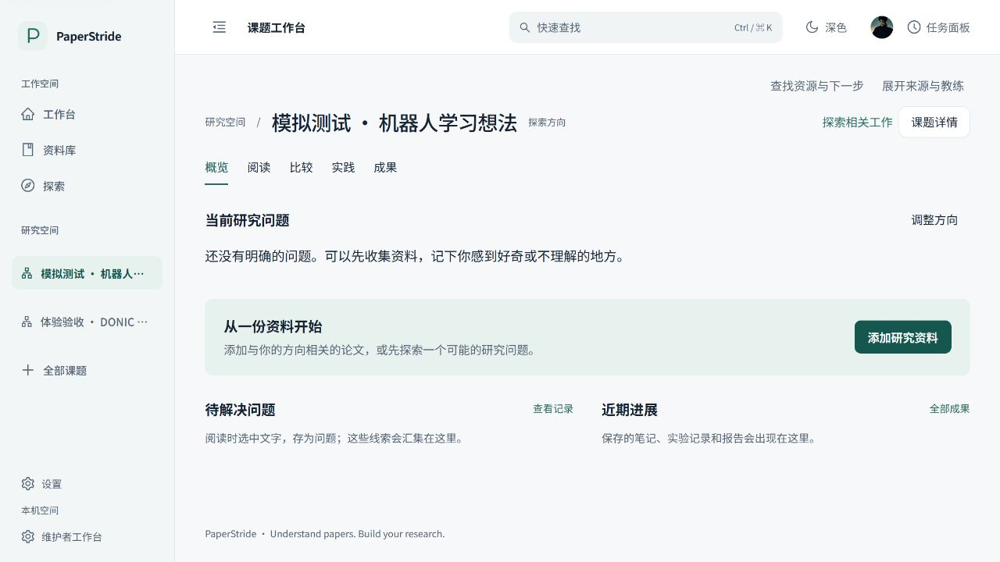

# PaperStride：LLM 模拟角色与导航任务试验

日期：2026-10-25。**本轮为模型代理试验，真人参与者为 0。**

## 目的与方法

验证是否能通过真实 API 让模型选择网页上的下一步，再在运行中的平台执行并核对。此轮限定为导航与名称创建，不评估学习效果、满意度或相对竞品优势。

同一个 `qwen3.8-flash` 使用四套虚构角色提示。每一步只收到合成任务、精简的当前可见控件文字及操作历史；没有收到标准答案、内部路由或源码。控件列表经过执行者筛选，未提供全部界面，也未将页面像素图像传入模型，因此比真实用户面对完整界面的条件简单。

模型返回控件 id、可选填写值和简短说明。Codex 使用现有浏览器工具执行；操作成功以实际页面状态判定，模型自述不作为成功依据。这是有人监督的 API 决策与浏览器执行，尚非无人值守代理。

仅发送虚构角色、合成任务和必要入口文字；未发送个人密钥、账号资料、私有笔记或论文全文。调用使用既有供应商和系统默认模型，没有更改个人模型偏好或启用整篇科研抽取。

## 真实结果

| 合成角色 | 任务范围 | 实际执行与终点 |
| --- | --- | --- |
| 科研入门者 | 找到自己的 PDF 上传入口，暂不上传 | 模型选择“打开资料库”→“添加论文”；实际出现“选择 PDF 文件”和“上传 PDF” |
| 熟练回访者 | 继续上次论文阅读 | 模型选择“继续上次任务”；恢复 DONIC 所属研究空间，第 2 页 |
| 跨领域学习者 | 找到图形或分层学习依赖入口 | 模型选择“探索”→“学习依赖”；实际显示学习依赖与 10 个知识点控件；未测试理解内容或完成学习 |
| 思路未定者 | 仅填写暂定名称建立研究空间 | 模型选择新建、填写名称、建立；创建“模拟测试 · 机器人学习想法”，研究问题仍为空 |

四个场景的指定终点均经浏览器核对，涉及 8 个模型选择的操作。**该结果不是人类任务完成率，也不是总体网页可用性评分。**

创建的空间为 `project-8925c09b93ae47d085fd94edbadf6e14`，保留在当前本机资料环境，标题明确标为模拟测试。

### 执行器适配与中断

本轮出现 3 处执行器适配，原始记录保留：

1. 资料页实际标题为“论文库”，执行器最初等待“资料库”超时；依据实际页面更正检查。
2. AntD 的 radio 原生 input 点击未命中；点击同一可见“学习依赖”文字标签成功。模型没有改选。
3. 新建空间目前是内嵌区域，执行器最初等待旧版 dialog 超时；依据实际内嵌表单继续。

这些是执行与断言定位问题，不能仅凭它们判断真人会困惑。也不能删去这些适配后将结果称为完全自动成功。

## API 与可复核记录

| 项目 | 数值 |
| --- | --- |
| 独立模型数 | 1，`qwen3.8-flash` |
| 合成角色 / 场景 | 4 / 4 |
| 实际 API 尝试 / HTTP 200 | 8 / 8 |
| 自动重试 | 0 |
| 输入 / 输出 token | 3219 / 255 |
| 供应商返回总 token | 3474 |
| 8 次 API 总等待时间 | 10.5739 秒，不含浏览器操作、执行者工作与页面等待 |
| 真人参与者 | 0 |

金额未根据 token 擅自换算；本报告未读取供应商账单。启动预检曾发现当前 shell 未继承凭据，该预检没有发送请求；随后复用启动脚本所用的 Windows 用户环境变量，未将凭据打印或写入试验文件。

[完整脱敏请求、模型响应与执行记录](simulated-users-2026-10-25/pilot-records.json)包含供应商响应 id、逐次时长及 token。响应中的 `browser_executed=false` 是模型决策生成时的状态，后续实际浏览器结果单独在 `execution` 中记录，二者不得混淆。

调用工具：[simulated_user_pilot.py](../../evaluation/research_atlas/simulated_user_pilot.py)。每个输出目录限定 8 次尝试，每次最多输出 600 token；先记录尝试，不自动重放不确定结果；只接受当前控件 id。需按顺序调用，未设计并发配额协调。

本轮离线防护检查 6 项通过，包括合成标记、重复控件、模型臆造控件、停止、文本长度和 8 次配额阻断。命令：

```powershell
backend/.venv/Scripts/python.exe -m unittest evaluation.research_atlas.test_simulated_user_pilot -v
```

## 可用于汇报的表述

> 我们采用 API 驱动的模拟角色开展任务流程试验，并用真实浏览器操作核对结果。首轮使用同一个模型的四套角色提示，完成资料上传入口发现、阅读恢复、学习依赖入口与名称创建四个导航任务，记录了请求用量和执行器适配。该轮没有招募真人，不将其作为学习效果或满意度证据。

可以把这种方法用于迭代前筛查和重复回归，也可以继续增加未知资源、条件冲突、关闭教学、来源恢复等预先定义的任务。判断规则应独立于扮演用户的模型；重复提示或更多模型代理不能折算成独立真人样本。

目前不能据此宣称用户学得更好、满意度更高、认知负担更低或优于竞品。模型扮演新手仍可能调用其已有知识，增加角色数量也不能消除模拟偏差。[相关研究](https://arxiv.org/abs/2402.01908)讨论了模型替代真实参与者时的代表性问题，本轮没有据此推算人的行为。


